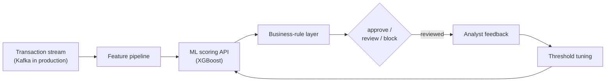

# Real-Time Fraud Detection — FinAI 360 Fraud Module

A clean-room demonstration of the fraud detection module from **FinAI 360**,
the intelligent banking automation suite I built at Edward Jones: real-time
transaction scoring, a business-rule layer, threshold tuning with analyst
feedback, and a scoring API designed to be called from Java microservices.

> **What this repo is:** a from-scratch re-implementation of the module's
> architecture and modeling approach, running on synthetic data. It contains
> no employer code, no customer data, and no production artifacts.
> Production outcomes below describe the production system; demo results
> describe this repo's synthetic-data runs.

## Production context

In production, the module scored millions of transactions a year in real
time: Apache Spark ML models behind Python scoring APIs, embedded in Spring
Boot microservices, fed by Kafka streams, with thresholds tuned alongside
fraud analysts and a layered validation step combining ML scores with
business rules and compliance checks.

Reported production outcomes:

- **Fraud losses down 65%**, **false positives down 40%**
- Real-time scoring at banking-transaction scale
- ~$4.2M saved annually from reduced fraud losses and fewer investigations

## Architecture



The demo simulates the Kafka stream in-process (`streaming_demo.py`) and
exposes the scorer as a Flask API (`scoring_api.py`), mirroring the
production pattern of Python ML APIs called from Spring Boot services.

## Demo results (synthetic data, measured)

50,000 synthetic transactions, 2.0% fraud, 75/25 train/test split:

| Model | ROC-AUC | PR-AUC |
| --- | --- | --- |
| XGBoost (supervised, class-weighted) | 0.957 | 0.754 |
| Isolation Forest (unsupervised baseline) | 0.901 | 0.368 |

Threshold trade-off on the test set (the same tuning analysts did in
production, here automated):

| Threshold | Precision | Recall | F1 |
| --- | --- | --- | --- |
| 0.5 | 0.34 | 0.77 | 0.47 |
| 0.7 | 0.53 | 0.72 | 0.61 |

The trade-off is the point: at 0.5 the model catches most fraud but flags
many legitimate transactions for review. Tuning the operating point against
analyst capacity is how false positives come down without losing coverage.

Reproduce with `python src/train.py` (SHAP explanation runs when the
`shap` package is installed, and is skipped gracefully otherwise).

## Run it

```bash
pip install -r requirements.txt

# Train, tune the threshold, save artifacts to models/
python src/train.py

# Stream 1,000 transactions through score + rules + decision
python src/streaming_demo.py --n 1000

# Serve the scorer (requires models/ from train.py)
python src/scoring_api.py
# POST /score  {"amount": 1250.0, "hour": 3, "merchant_category": "electronics",
#               "device_type": "mobile", "account_age_days": 45, "distance_km": 820.0,
#               "txns_last_24h": 7, "is_new_device": 1, "is_international": 1}
# -> {"risk_score": ..., "decision": "review|block|approve", "rules_triggered": [...]}
```

Tests: `python -m pytest tests/ -q` (CI runs compile checks + tests on
every push).

## Project structure

```
src/
  generate_data.py    synthetic transactions: legit vs fraud profiles
  train.py            XGBoost + Isolation Forest baseline, threshold tuning, SHAP
  rules.py            business-rule layer + approve/review/block decision
  scoring_api.py      Flask scoring API (the microservice integration point)
  streaming_demo.py   simulated Kafka stream -> score -> rules -> decision
tests/
  test_smoke.py       data, rules, and decision checks
```

## Tech stack

Python, XGBoost, scikit-learn, pandas, Flask, SHAP — demonstrating the
modeling and integration patterns of the production Spark ML / Kafka /
Spring Boot system in a runnable, dependency-light form.

## License

MIT
